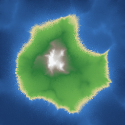
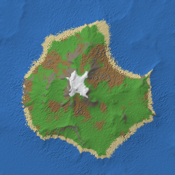
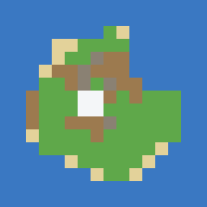

# TerrainMapGeneration

Herramienta gratuita en C# (.NET 10) que convierte un **heightmap** (mapa de alturas en escala de
grises) en un **mapa de terreno por capas** listo para un juego 2D de vista cenital por tiles, estilo
Pokémon: simula erosión, decide dónde hay agua, arena, pasto, tierra, roca o nieve, y exporta
máscaras, splatmaps RGBA y un mapa de tiles (PNG + CSV + JSON).

| Coloreado por altura | Capas + relieve | Mapa de tiles (16 px) |
|:---:|:---:|:---:|
|  |  |  |

Sin dependencias externas: solo el SDK de .NET (el PNG se lee y escribe con un códec propio).

## Inicio rápido

Requisitos: [.NET SDK 10.0](https://dotnet.microsoft.com/download) y Git.

```bash
git clone https://github.com/pollorijas/TerrainMapGeneration.git
cd TerrainMapGeneration
dotnet test
dotnet run --project src/TerrainMapGeneration.Cli -- run samples/projects/default.json
```

El último comando procesa la isla de ejemplo (`samples/heightmaps/island_256.png`) y deja los
resultados en `output/island_256/` (la carpeta `output/` está en `.gitignore`).

### Con tu propio heightmap

```bash
dotnet run --project src/TerrainMapGeneration.Cli -- init mi_mapa.json
```

Edita `"input"` en `mi_mapa.json` con la ruta de tu PNG y ejecuta:

```bash
dotnet run --project src/TerrainMapGeneration.Cli -- run mi_mapa.json
```

Para tener el comando `terrain` sin `dotnet run`, publica la herramienta una vez:

```bash
dotnet publish src/TerrainMapGeneration.Cli -c Release -o tools/terrain
```

### Comandos

| Comando | Qué hace |
|---|---|
| `terrain init [proyecto.json]` | Crea un proyecto con la configuración por defecto (no sobrescribe). |
| `terrain run <proyecto.json>` | Ejecuta todo el proceso y exporta los mapas. |
| `terrain colorize <entrada.png> <salida.png>` | Solo colorea por altura, sin erosión ni capas. |

## Cómo funciona

```
heightmap.png → alturas [0,1] → erosión térmica → erosión hidráulica → pendiente
             → máscaras por capa (altura, pendiente, erosión) → splatmaps / vista previa / tiles
```

1. **Carga**: PNG en gris de 1–16 bits (recomendado **16 bits**; con 8 bits la erosión deja
   "terrazas"). Los PNG en color se convierten a luminancia.
2. **Erosión térmica**: el material se desmorona donde la pendiente supera el ángulo de reposo.
3. **Erosión hidráulica**: miles de gotas bajan por el terreno arrastrando y depositando sedimento
   (método de Beyer, 2015). Produce también mapas de dónde se erosionó y dónde se depositó.
4. **Máscaras**: cada capa tiene reglas de rango (altura, pendiente, erosión, depósito) con bordes
   suaves; en cada píxel los pesos de todas las capas suman 1.
5. **Exportación**: ver la tabla siguiente.

## Archivos generados

| Archivo | Contenido |
|---|---|
| `heightmap_eroded.png` | Heightmap tras la erosión (gris 16 bits). |
| `height_colors.png` | Mapa RGB coloreado solo por altura. |
| `preview.png` | Colores de las capas mezclados, con sombreado de relieve. |
| `slope.png` | Pendiente (negro = plano, blanco = vertical). |
| `erosion.png`, `deposition.png` | Dónde la erosión hidráulica quitó o dejó material. |
| `masks/mask_<capa>.png` | Peso de cada capa (gris 8 bits); útil para editar a mano en GIMP/Krita. |
| `splatmap_N.png` + `splatmaps.json` | 4 capas por imagen en R, G, B, A; el JSON dice qué capa va en cada canal. |
| `tiles.png` / `tiles_full.png` | Color de la capa de cada tile (1 px por tile / a tamaño real). |
| `tiles.csv` | Id de capa de cada tile, una fila por línea (sirve como capa CSV en Tiled). |
| `tiles.json` | Leyenda: id → nombre y color, ancho y alto en tiles, tamaño del tile. |

Para usar el resultado en un juego (por ejemplo con MonoGame): lee `tiles.csv` como matriz de ids,
usa `tiles.json` para saber qué es cada id y dibuja el tile correspondiente de tu tileset.

## Proyecto (JSON)

`terrain init` genera un archivo con todos los valores por defecto. Se admiten comentarios `//` y
cualquier propiedad omitida toma su valor por defecto. Lo más importante:

| Propiedad | Por defecto | Efecto |
|---|---|---|
| `input`, `outputDirectory` | — | Rutas relativas al archivo del proyecto. |
| `heightScale` | 32 | Altura máxima del terreno en píxeles horizontales. Más alto ⇒ pendientes mayores ⇒ más roca. |
| `normalizeInput` | `false` | Estira la entrada para que use todo el rango [0, 1]. |
| `thermal` | 50 iteraciones, talud 35° | `null` para desactivarla. |
| `hydraulic.droplets` | 50 000 | Más gotas ⇒ erosión más marcada. ~1 gota por píxel es un buen punto de partida. |
| `hydraulic.seed` | 0 | Cambia la semilla para obtener otra variante del mismo mapa. |
| `maskSmoothingRadius` | 1 | Suaviza pendiente y erosión antes de calcular las capas. |
| `layers` | 6 capas | Nombre, color y reglas `altitude`, `slope` (grados), `erosion`, `deposition`. |
| `fallbackLayer` | `"roca"` | Capa usada donde ninguna regla aplica. |
| `tileSize` | 16 | Píxeles del heightmap por tile. |

Una regla de rango tiene `min`, `max` (opcionales) y `falloff`, el ancho de la transición suave,
**centrada** en cada borde. Si dos capas comparten un borde con el mismo `falloff`, sus pesos suman
exactamente 1 en la transición. Ejemplo de capa:

```json
{
  "name": "pasto",
  "color": "#5FA84A",
  "altitude": { "min": 0.25, "max": 0.78, "falloff": 0.02 },
  "slope": { "max": 30, "falloff": 10 },
  "erosion": { "max": 0.45, "falloff": 0.3 }
}
```

## Estructura del código

```
src/
  TerrainMapGeneration.Core/      Algoritmos puros (sin archivos ni imágenes): FloatMap, erosión,
                                  pendiente, capas/máscaras, splatmaps, tiles, proyecto y pipeline
  TerrainMapGeneration.Imaging/   Códec PNG propio, lectura de heightmaps y escritura de resultados
  TerrainMapGeneration.Cli/       Comando `terrain`
tests/                            Pruebas xUnit (mapas sintéticos + PNG de Pillow/ImageMagick)
samples/                          Heightmap y proyecto de ejemplo
docs/PLAN.md                      Investigación, decisiones y hoja de ruta
```

## Licencia

Apache 2.0 (ver [LICENSE](LICENSE)).
